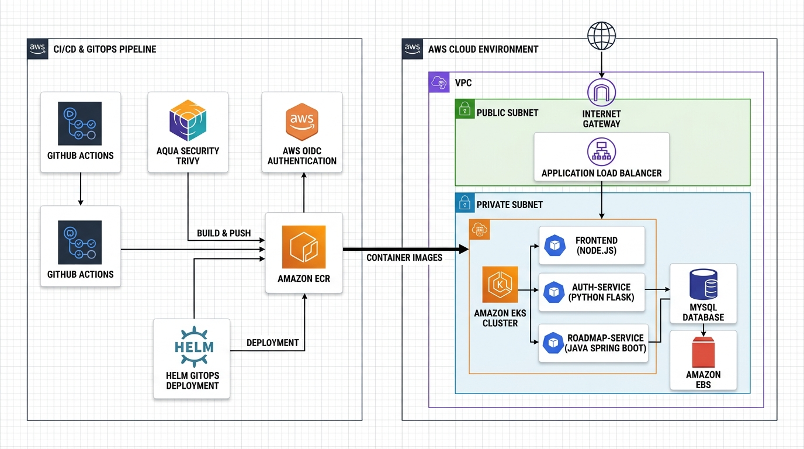
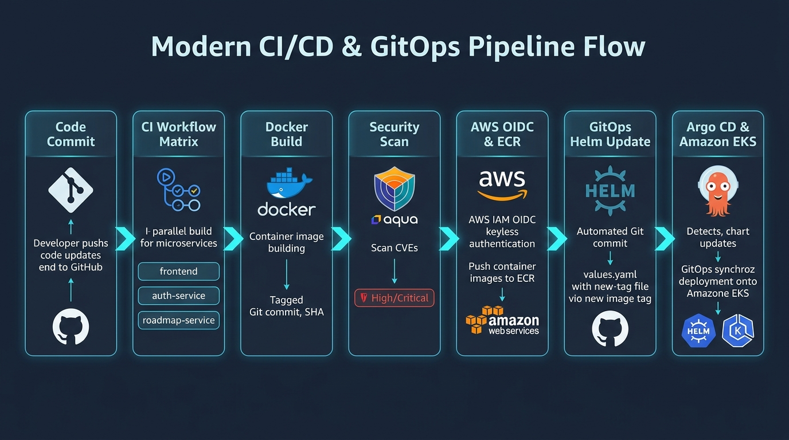

# CloudDevOps Microservices & Infrastructure Platform

> **Live Application Endpoint (AWS ELB):**  
> [http://a5988353b78e74f39b835aca0b168b15-1907081452.eu-north-1.elb.amazonaws.com](http://a5988353b78e74f39b835aca0b168b15-1907081452.eu-north-1.elb.amazonaws.com)

A cloud-native microservices platform featuring containerization, Infrastructure as Code (IaC) with Terraform on AWS (EKS, VPC, ECR), automated CI/CD pipelines via GitHub Actions (with Trivy vulnerability scanning and GitOps deployment triggers), Kubernetes manifests, and Helm charts.

---

## Architecture Overview



---

## Services & Tech Stack

| Service | Technology | Port | Description |
|---|---|---|---|
| **frontend** | Node.js / Express / EJS | `3000` | Web UI rendering views and interacting with backend APIs |
| **auth-service** | Python / Flask / PyMySQL | `5000` | User authentication and credentials verification against MySQL |
| **roadmap-service** | Java / Spring Boot / Maven | `8080` | Manages and serves roadmap/learning path data |
| **mysql** | MySQL 8.0 | `3306` | Persistent database storing authentication & application records |

---

## Repository Structure

```
clouddevops/
├── .github/workflows/         # GitHub Actions CI/CD workflows (OIDC, Trivy, ECR publish)
├── app/                       # Microservice application source code
│   ├── auth-service/          # Python Flask authentication service
│   ├── frontend/              # Node.js Express frontend
│   └── roadmap-service/       # Java Spring Boot roadmap service
├── compose/                   # Docker Compose setup for local development
│   └── compose.yaml
├── helm/                      # Helm charts for Kubernetes deployments
│   ├── auth-service/
│   ├── frontend/
│   └── roadmap-service/
├── k8s/                       # Base Kubernetes configuration (Namespace, ConfigMap, Secrets, StorageClass)
├── terraform/                 # Infrastructure as Code for AWS (VPC, EKS, ECR, GitHub OIDC)
│   ├── modules/               # Reusable modules (vpc, eks, ecr)
│   ├── backend.tf
│   ├── github_oidc.tf
│   └── provider.tf
└── yaml/                      # Standalone raw Kubernetes manifests (Deployments, Services, Ingress)
```

---

## Getting Started

### 1. Local Development (Docker Compose)

Run the full application stack locally without cloud dependencies:

```bash
cd compose
docker compose up --build
```

- **Frontend:** [http://localhost:3000](http://localhost:3000)
- **Auth Service:** `http://localhost:5000`
- **Roadmap Service:** `http://localhost:8080`
- **MySQL:** `localhost:3306`

To stop and remove containers and volumes:
```bash
docker compose down -v
```

---

## Infrastructure Provisioning (Terraform)

The Terraform configuration provisions the AWS infrastructure:
- **VPC Module:** Public and private subnets across multi-AZs, NAT Gateway, Internet Gateway, and NACLs.
- **EKS Module:** Amazon EKS Managed Kubernetes Cluster with worker nodes residing in private subnets.
- **ECR Module:** Container repositories for `frontend`, `auth-service`, and `roadmap-service`.
- **GitHub OIDC:** OpenID Connect role allowing GitHub Actions to authenticate without static AWS keys.

### Deployment Steps:

1. Navigate to the Terraform directory:
   ```bash
   cd terraform
   ```

2. Configure backend and variables:
   - Ensure the S3 backend bucket in `backend.tf` exists in your AWS region.
   - Adjust variables in `terraform.tfvars`.

3. Initialize and apply:
   ```bash
   terraform init
   terraform plan
   terraform apply
   ```

4. Retrieve the OIDC Role ARN:
   ```bash
   terraform output gh_oidc_role
   ```

---

## CI/CD & GitOps Pipeline



Configured in `.github/workflows/`:

1. **Trigger:** Commits to `main` with changes under `app/<service>/**`.
2. **Build:** Builds the container image tagged with `$GITHUB_SHA`.
3. **Security Scan:** Scans container image using **Aqua Security Trivy** (reporting `HIGH,CRITICAL`).
4. **AWS OIDC Login:** Assumes AWS IAM role via OpenID Connect (no long-lived AWS keys).
5. **ECR Push:** Pushes both commit SHA and `latest` tags to Amazon ECR.
6. **GitOps Tag Update:** Updates image tag in `helm/<service>/values.yaml` and commits back to `main`, ready for GitOps synchronization (e.g., via Argo CD).

### Required GitHub Secrets & Variables:
- `AWS_ROLE_ARN` *(Secret)*: ARN of the OIDC IAM role created by Terraform.
- `AWS_REGION` *(Variable)*: AWS target region (e.g., `eu-north-1`).

---

## Kubernetes & Helm Deployment

### 1. Base Cluster Configuration
Apply core manifests in the `ivolve` namespace:
```bash
kubectl apply -f k8s/namespace.yaml
kubectl apply -f k8s/storageclass.yaml
kubectl apply -f k8s/configmap.yaml
kubectl apply -f k8s/secret.yaml
kubectl apply -f k8s/mysql-statefulset.yaml
```

### 2. Deploy Microservices via Helm
Deploy each microservice chart into the cluster:
```bash
helm upgrade --install auth-service ./helm/auth-service -n ivolve
helm upgrade --install roadmap-service ./helm/roadmap-service -n ivolve
helm upgrade --install frontend ./helm/frontend -n ivolve
```

Alternatively, raw Kubernetes manifests in `yaml/` can be applied directly with `kubectl apply -f yaml/`.

---

## Verification & Deployment Evidence

Concrete CLI output verifying each tier of the project:

### 1. Ingress & AWS Load Balancer Verification
The `frontend-frontend-ingress` resource is provisioned with `ingressClassName: nginx` and bound to the AWS Elastic Load Balancer:

```bash
$ kubectl get ingress -n ivolve -o wide
NAME                        CLASS   HOSTS   ADDRESS                                                                    PORTS   AGE
frontend-frontend-ingress   nginx   *       a5988353b78e74f39b835aca0b168b15-1907081452.eu-north-1.elb.amazonaws.com   80      2d21h
```

Testing HTTP availability against the live ELB endpoint confirms a `200 OK` response directly from the Node.js/Express frontend:
```bash
$ curl -I http://a5988353b78e74f39b835aca0b168b15-1907081452.eu-north-1.elb.amazonaws.com
HTTP/1.1 200 OK
Date: Sun, 22 Nov 2026 16:58:08 GMT
Content-Type: text/html; charset=utf-8
Content-Length: 1815
Connection: keep-alive
X-Powered-By: Express
ETag: W/"717-w9urRwoB7lqm6azNGZHRa3fq5y8"
```

### 2. Active Cluster Workloads (`kubectl get pods -n ivolve`)
Verification of all active pods running in the `ivolve` namespace across worker nodes:

```bash
$ kubectl get pods -n ivolve -o wide
NAME                                                READY   STATUS    RESTARTS   AGE   IP           NODE
frontend-frontend-77cc67c599-dfvg7                  1/1     Running   0          14m   10.0.2.213   ip-10-0-2-121.eu-north-1.compute.internal
auth-services-auth-service-6fb969c778-fbc82         1/1     Running   0          62m   10.0.2.82    ip-10-0-2-121.eu-north-1.compute.internal
roadmap-services-roadmap-service-7fbccbb855-cfdgg   1/1     Running   0          35m   10.0.2.69    ip-10-0-2-121.eu-north-1.compute.internal
mysql-0                                             1/1     Running   0          2d    10.0.4.16    ip-10-0-4-109.eu-north-1.compute.internal
```

### 3. Persistent Storage Verification (`kubectl get pvc,storageclass -n ivolve`)
Stateful MySQL database persistence backed by Amazon EBS CSI driver:

```bash
$ kubectl get pvc,storageclass -n ivolve
NAME                                       STATUS   VOLUME                                     CAPACITY   ACCESS MODES   STORAGECLASS
persistentvolumeclaim/mysql-data-mysql-0   Bound    pvc-3559aece-c4e2-4b38-8f4a-64c52ba755a7   2Gi        RWO            ebs-sc

NAME                                 PROVISIONER       RECLAIMPOLICY   VOLUMEBINDINGMODE
storageclass.storage.k8s.io/ebs-sc   ebs.csi.aws.com   Retain          WaitForFirstConsumer
```

### 4. Helm Charts Validation (`helm lint helm/*`)
All 3 application Helm charts validated cleanly without errors:

```bash
$ helm lint helm/*
==> Linting helm/auth-service
[INFO] Chart.yaml: icon is recommended
==> Linting helm/frontend
[INFO] Chart.yaml: icon is recommended
==> Linting helm/roadmap-service
[INFO] Chart.yaml: icon is recommended

3 chart(s) linted, 0 chart(s) failed
```

### 5. GitOps Automation History (`git log --oneline -n 5`)
Evidence of the CI/CD pipeline triggering automated image tag updates committed to Helm values on `main`:

```bash
$ git log --oneline -n 5
627bdaf edit front
2478af4 Deploy roadmap-service image from 60a709565bbd29b63a9bdbd83c683d3898ee5327
164ae05 Deploy auth-service image from 60a709565bbd29b63a9bdbd83c683d3898ee5327
2883101 Deploy frontend image from 60a709565bbd29b63a9bdbd83c683d3898ee5327
60a7095 fix
```
